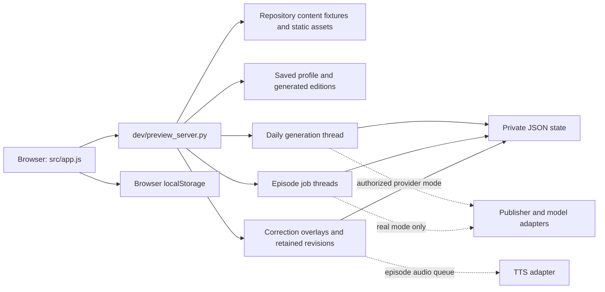
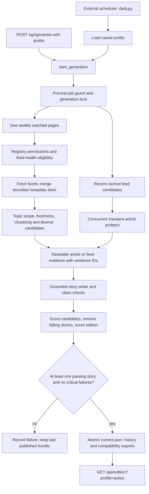
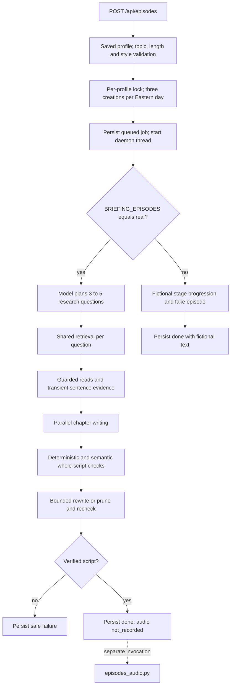

# Web briefing architecture

Code baseline: integration commit `e17d690` (`morrow/design-008-web`), reviewed
18 November 2026. This describes the browser application and Python preview
backend at that revision. Backlog issues and design proposals are not evidence
that a feature is implemented. Native client code is outside this document.

**Current operating mode: fixtures only.** Provider credits are exhausted. Use
mocks and the unit test suite (see the runbook); do not run real generation,
retrieval, TTS or provider acceptance. See [the runbook](runbook.md).

## Components and boundaries



The server is a Python HTTP server with static-file allowlists and loopback-only
API access, bounded request bodies and per-route POST limits. It is a local,
single-user preview, not an authenticated multi-user service. Profile hashes
separate content directories; they are not authentication credentials. There is
no database, external queue broker or scheduler in this source tree. Static
reading and existing generated text do not require an available model provider.

`POST /api/profile` saves the validated profile; `GET /api/profile` retrieves it.
`POST /api/interpret` calls the model to turn interest prose into structured
topics. Saving a profile and interpreting it are different operations. Browser
storage retains interests, reading/listening positions, saves, feedback, signals
and suggestion snoozes; those records are not automatically a server-side backup.

## Daily edition

Entry points: [daily.py](../dev/ingest/daily.py),
[generation_api.py](../dev/ingest/generation_api.py),
[write_edition.py](../dev/ingest/write_edition.py),
[score_edition.py](../dev/ingest/score_edition.py).



The normal job runs configured weekly watched pages before feed ingestion. It
uses recent cached candidates to begin article reads while feeds run; feeds on
those occupied hosts can be skipped as `recent_feed_article_first`. The source
registry remains authoritative for enabled status, robots and article access.
Feed bodies and article text are runtime evidence, not a full-text archive.

The writer ranks each topic's items, applies include/exclude scope, uses a
seven-day freshness window and clusters related reporting. Candidate attempts
are bounded and shared stories can cover more than one topic. It extracts
sentence-addressable evidence, writes source-linked claims, checks support and
adds coverage rows for quiet or limited topics. Quick hits are distinct from
full checked stories. Optional credibility metadata does not replace claim checks.

The production generation wrapper allows a **thin day of one or two passing
stories**, with an explicit notice. Zero passing stories or a critical scorecard
failure blocks publication. The separate real-build acceptance threshold is
three substantive stories; passing publication is not passing that acceptance.

Scheduled runs publish under `generated/default/` and copy the result and history
to the saved profile's directory. Interactive runs publish under
`generated/profiles/<profile-id>/`. The ID is the first 24 hex characters of a
SHA-256 of canonical profile JSON; changing profile content changes that ID.
The bare `/api/edition` selects the scheduled default, while
`/api/edition?profile=active` selects the saved profile. Legacy top-level
generated files may be copied on first access, with an owner marker preventing
reuse by a different profile. Even a GET can perform this legacy migration.

`current.json` is the authoritative atomic edition/source/scorecard bundle.
Separate `editions.json`, `sources.json` and `scorecard.json` are compatibility
exports, not a cross-file transaction. History keeps the newest seven distinct
revisions, not necessarily seven days. A failed build keeps the prior edition;
status and per-job scorecards explain the failure. `daily.py` adds the aggregate
`daily_run` report to `status.json` and exits 0 on completion, 1 on failure.

### Daily execution limits

| Setting in code | Default |
| --- | --- |
| Generation wall-clock budget / finalize reserve | 90 s / 10 s |
| Feed budget / article extraction budget | 20 s / 45 s |
| Model calls / article fetches per run | 18 / 24 |
| Recent-feed prefetch eligibility | 2 hours |
| Requested maximum stories / candidate attempt ceiling | 8 / 24 |
| Concurrent story workers / candidate budget | 3 / 40 s |
| Model request timeout per story | 25 s, clamped to deadlines |
| Prompt evidence per story | At most 12 sentences and 7,000 characters |
| Edition date timezone | `America/New_York`, fixed in writer code |

These are cooperative budgets, not a durable job system with process-kill
deadlines. The watched-page work precedes the feed phase. Check actual elapsed
time and status rather than treating 90 seconds as an availability guarantee.

## Episodes and jobs

Sources: [jobs.py](../dev/ingest/jobs.py),
[episodes/generate.py](../dev/ingest/episodes/generate.py).



Requests contain exactly `topic`, `length` (5, 10 or 15 minutes) and `style`
(`news-brief`, `explainer`, `conversational`). Topic validation restricts length
and characters. `GET /api/episodes`, `GET /api/episodes/<job-id>` and
`POST /api/episodes/<job-id>/cancel` use the active saved profile. Quota counts
all creations that day, including failed/cancelled jobs. A new request is a new
job; there is no request idempotency key or implemented retry endpoint.

Job stages are `queued`, `researching`, `reading`, `checking`, `writing`,
`recording`; terminal states are `done`, `failed`, `cancelled`. Fake jobs simulate
stages with a four-second delay and at most three attempts. Real jobs have one
attempt and share a process-local semaphore of size one. They generate text,
not an audio recording: `done` does not imply playable audio. Cancellation is
checked around expensive work; it cannot undo a provider charge already incurred.
JSON survives a restart, but daemon threads, cancellation events and the
semaphore do not. Startup does not resume interrupted jobs; there are no leases,
heartbeats or cross-process real-worker scheduling guarantees.

Real generation has a 335-second cooperative budget. It searches 3–5 questions
with at most three logical provider queries each, deduplicates URLs, limits one
host to three candidates and tries at most 20 reads to obtain up to 12 readable
pages. Search and read windows are capped at 50 and 85 seconds respectively.
Chapter targets use 150 words/minute. The first draft writes chapters in
parallel; a second draft may repair the whole script, followed by up to three
prune-and-recheck passes. Unsupported claims never become spoken text merely to
fill duration. Returned durations are estimates until audio exists; shorter
verified scripts carry an explicit shortfall notice.

The separate [retrieval/multiround.py](../dev/ingest/retrieval/multiround.py)
accepts explicit `FixtureResearch` documents only: no provider calls, DNS or disk
I/O. Its defaults are three rounds, 15 queries, 20 reads, 120,000 characters and
30 seconds, with two distinct source bodies/four passages per question. At this
baseline it is **not wired into the real episode generator**. Structural fixture
coverage is not semantic verification.

## Retrieval, credibility and extraction


[retrieval/](../dev/ingest/retrieval/__init__.py) fans out to eligible providers;
the configured order `gemini, gdelt, feeds` is not a serial fallback chain.
Perplexity is implemented but absent from the default order. Default budgets are
20 seconds, four logical queries, 20 merged results, ten results/provider, four
workers and one-week freshness. Paid search adapters each default to 24 requests
per UTC day. Their counter is separate from the Eastern-day cost ledger.
Gemini grounding retains URL/title hints, never the grounded answer as evidence.
Feed evidence may travel transiently with an eligible candidate.

The separately constructed [DomainRouter](../dev/ingest/retrieval/domain/__init__.py)
offers SEC EDGAR, FRED, BLS, Europe PMC, Crossref, OpenAlex and Wikipedia metadata
adapters with keyword routing and GDELT fallback. It is not selected by the
default provider factory. Keys/contact details are explicit constructor inputs;
it does not load additional secret files. Metadata licensing does not establish
permission to reuse an underlying paper, filing or article. New public URL reads
use the guarded transient-read policy; a known registry restriction still wins.

Merging counts agreement among discovery providers, not independent reporting
origins. The optional resilience layer shares process-local host serialization,
provider health, a 60-second negative cache (256 entries), and 5, 10, 20…300-second
backoff; `Retry-After` can extend it. There is one attempt per provider/search,
with later eligible recovery probes. None of this cache survives restart.
With resilience off, GDELT still has its own 60-second, 256-entry negative cache,
five-second request spacing and at most one within-budget retry on HTTP 429.

[credibility.py](../dev/ingest/credibility.py) uses
`content/source-tiers.json` for explainable authority, primary-document,
publication-freshness, readability and reporting-independence signals. Domain
boundaries, publication dates, syndication and identical-body detection matter;
a `.gov` suffix or provider agreement alone does not establish claim truth.
Unread search hits cannot corroborate. Optional lexical event clustering is
available through `assess_bundle(..., event_dedupe=True)` (seven-day default),
not an environment flag or the default ranking path. Rights remain independent
of credibility. See [source-credibility.md](source-credibility.md).

[core.fetch_article_text](../dev/ingest/core.py) checks approved domains,
article-access policy, declared paywalls, robots and host spacing. Network guards
reject private/local destinations and validate redirects. Responses are bounded
at 2,000,000 bytes; normal fetch timeout is 12 seconds, clamped to a supplied
deadline. Text extraction is capped at 12,000 characters.

With `BRIEFING_EXTRACTION=on`, [extract/](../dev/ingest/extract/__init__.py) parses
bytes in an isolated subprocess: HTML readability scoring then semantic/prose
fallbacks; PDF text-layer extraction with `pypdf`; explicit plain text. No OCR,
JavaScript execution, remote rendering or paywall bypass. Guards include three
wall-clock seconds, 256 MiB address space, two CPU seconds, 12,000 HTML nodes,
depth 128 and 40 PDF pages. Missing `pypdf` fails PDF extraction explicitly.
See [extract.md](extract.md) for fallback refusals and dependency details.

## Corrections and audio

```mermaid
sequenceDiagram
    participant Editor as Local editor
    participant API as Correction API
    participant Log as Profile correction log
    participant Read as Edition or episode response
    participant TTS as Episode audio queue
    Editor->>API: Old text, replacement, target, optional evidence/revision
    API->>API: Serialize profile publication; validate current revision
    API->>Log: Atomic append-by-replacement; retain before/after snapshots
    Log->>Read: Overlay corrected text and new revision/script hash
    Read->>Read: Supersede audio; clear stale chapter times
    API->>TTS: Episode only: enqueue corrected script
    TTS-->>Read: Current matching recording or failed/pending state
```

[corrections.py](../dev/ingest/corrections.py) handles daily-story paragraph or
sentence patches and completed-episode sentence patches. Exact old text is
required; optional `previous_revision_id` strengthens the precondition. A stale
edit returns 409. Evidence references validate source membership and retain
editor-supplied quotes; they do not fetch or independently verify those quotes.
Private append-only events retain snapshots, text and evidence. API log responses
use an allowlist that excludes snapshots, replacement text and quote contents.

Read endpoints overlay corrections on current/history content. Retained revision
routes return `historical: true`, `playback_allowed: false`, and `no-store`.
Retention starts with the correction event; it cannot reconstruct missing older
snapshots. Daily audio is superseded without a daily replacement-TTS worker.
Episode corrections enqueue the TTS renderer and mark stale audio; its GET route
returns 409 until the current asset matches. **This queue is independent of
`BRIEFING_EPISODES=fake`: correction tests must stub it.** See
[corrections.md](corrections.md).

[episodes_audio.py](../dev/ingest/episodes_audio.py) renders exact chapter text,
retries a segment at most three times, checks PCM/WAV compatibility, stitches one
WAV and measures chapter offsets. It publishes a staging directory atomically
with chapter WAVs, `episode.wav`, `episode.json` and `manifest.json`. The asset key
includes revision/script, voice, provider and model; a complete matching asset is
reused with zero provider calls. Failed renders remove staging output. Audio GETs
validate ownership, hashes and current configuration and support byte ranges.
WebVTT requires a completed job, no pending correction-audio invalidation and
valid sentence timings. Its route does not independently validate an audio
manifest; chapter offsets alone do not supply sentence-level alignment.

The default voice is `Sulafat` unless `voice.json` selects an allowed audition
voice; the TTS model is `gemini-3.8-flash-lite-tts`. This is separate from the
static-content export → recording validation → approved proposal tools
(`export_narration.py`, `prepare_recording.py`, `propose_recording.py`). Neither
path creates an automatic daily narration worker.

## Storage and transient data

`STATE` below means `BRIEFING_STATE_DIR`. If unset/empty, [paths.py](../dev/ingest/paths.py)
uses the runtime account's home-local state directory named `briefing` (the
standard `.local` → `state` hierarchy). Runtime paths below are relative to that
root; they are not repository files. Set the variable **before process startup**;
many module constants bind it at import. No `XDG_STATE_HOME` override is read.

| Location relative to STATE | Stored data and lifetime |
| --- | --- |
| `profile.json` | Saved interest profile, including user-supplied text; replaced on save |
| `ingested-items.json` | URLs, titles ≤240 chars, snippets ≤280 chars, timestamps, topic IDs, rights version and hashes; pruned on saves to 30 days |
| `ingested-items.validators.json` | Source ETag/Last-Modified validators for conditional feed requests |
| `ingested-items.robots.json` | Robots policy cache; rechecked after seven days |
| `feed-health.json` | Failure/retry/retirement state per source; independent of article retention |
| `status.json` | Last run outcome and counts; scheduled CLI also adds `daily_run` |
| `generation.lock`, `ingestion.disabled` | Cross-process daily lock; presence-based ingestion kill switch |
| `generated/default/`, `generated/profiles/<profile-id>/` | Atomic current bundle, exports, prior exports, seven-revision history, `jobs/<job-id>.scorecard.json` diagnostics |
| `generated/legacy-profile-owner.json` | Legacy migration ownership; original top-level files remain recovery copies |
| `episode-jobs/profiles/<profile-id>/<job-id>.json` | Request, timestamps, stage, counts, terminal result and generated episode text; no automatic retention sweep |
| `episode-jobs/retrieval/retrieval-counts.json` | Real episode search request counter; resets its bucket on UTC date change |
| `episodes/profiles/<profile-id>/audio/<episode-id>/<asset-key>/` | Versioned WAVs and manifest; no automatic old-asset pruning |
| `corrections/profiles/<profile-id>/*.jsonl` | Correction events, private evidence quotes and retained snapshots; per-profile publication lock |
| `corrections/profiles/<profile-id>/audio-jobs/<correction-id>.json` | Persisted regeneration status; worker threads themselves are not durable |
| `voice.json` | Selected allowed narrator voice |
| `usage-ledger.json`, `usage-ledger.lock` | Count/cost buckets, reservations and denials; no queries, text, URLs or keys |
| `retrieval-counts.json` | Search counters when the default retrieval config uses STATE; other callers may supply a different root |
| `discovery-state.json` | Watched-page check metadata, digest, bounded snippet and supported bounded data points; FRED watches retain status only |
| `discovered-sources.json` | Staged discovery metadata; never automatically inserts enabled feeds into the tracked registry |

Lock/temp files accompany atomic updates. New histories,
episode artifacts and correction records require operator retention planning;
the 30-day feed policy does not apply to all state.

Full fetched bodies, PDF bytes, extracted article text, prompt evidence maps and
model responses used during checking are transient. Generated scripts, source
metadata, hashes/locators, scorecards and explicitly bounded snippets persist.
Correction evidence quotes are a deliberate private-storage exception.
`BRIEFING_EVIDENCE_PACKS=on` changes the daily runtime evidence representation;
serialization stores hashes and only explicitly `may_cache` bounded excerpts
(180 chars each, 2,400 total). The optional URL cache defaults to a 24-hour TTL,
has no default filesystem location and is not automatically enabled by that
flag. See [evidence-packs.md](evidence-packs.md).

Browser `localStorage` keys include `briefing:v1:state`, `interest-profile`,
`signals` and `interest-snoozes` (the latter three also use the `briefing:v1:`
prefix). Clearing browser storage loses those local records. Provider keys and
operator tooling state live outside both repository content and application
state; see the runbook for safe credential checks.

## Configuration defaults

These are the environment variables read by the application or its supported
developer tools. Variables used only by old runbooks or abandoned experiments
are intentionally absent. Test-only paths are marked so they are not mistaken
for production settings.

| Variable | Default / enabling value | Read by |
| --- | --- | --- |
| `BRIEFING_STATE_DIR` | Home-local state path | Backend state and test isolation |
| `BRIEFING_DATA_DIR` | `~/.local/share/briefing` | Local sources, backups and audio |
| `BRIEFING_LOCAL_SOURCES` | Unset | Optional local source catalog |
| `BRIEFING_FLAGS_FILE` | State `flags.json` | Runtime feature flags |
| `BRIEFING_EPISODES` | `real` in production; `fake` in tests | Episode job mode |
| `BRIEFING_TTS` | Enabled; `0`/`off` disables | Audio jobs and guards |
| `BRIEFING_DAILY_NARRATION`, `BRIEFING_DAILY_AUDIO` | Disabled unless enabled | Daily narration/audio |
| `BRIEFING_DAILY_TARGET_MIN` | Five minutes | Daily writer |
| `BRIEFING_EPISODE_THINKING` | `off` | Episode model client |
| `BRIEFING_EPISODE_FALLBACK_MODEL` | Off; `on` enables guarded sparse-evidence host pass | Episode fallback writer |
| `BRIEFING_EXTRACTION`, `BRIEFING_EVIDENCE_PACKS` | Off; `on` enables | Retrieval and daily evidence |
| `BRIEFING_CREDIBILITY`, `BRIEFING_RELEVANCE`, `BRIEFING_RELEVANCE_TUNE` | Off; `1`/`on` enables | Retrieval and daily scoring |
| `BRIEFING_RETRIEVAL_FILL`, `BRIEFING_RETRIEVAL_RESILIENCE` | Off; `on` enables | Retrieval controls |
| `BRIEFING_FRESHNESS_DAYS`, `BRIEFING_CANDIDATE_ATTEMPT_LIMIT` | 90 / 30 | Validated runtime flags |
| `BRIEFING_TIMEZONE` | `America/New_York` | Morning report date comparison |
| `BRIEFING_LIVE_URL`, `BRIEFING_URL` | Unset | Status and morning checks |
| `BRIEFING_SHOT_DIR`, `BRIEFING_CAPTURE_DIR` | Test-specific temporary paths | Browser evidence (test-only) |
| `BRIEFING_TESTING`, `BRIEFING_TEST_LEDGER_DIR` | Unset | Fixture test guard and ledger (test-only) |

Model choice is a code constant, not a supported model environment variable:
text defaults to `gemini-3.5-flash` in `interpreter_proxy.py`; named fallback and
alternate constants do not provide automatic failover. Grounding defaults to
`gemini-3-flash-preview` in `RetrievalConfig`. Provider order, result caps and
key-file overrides are configuration objects or CLI arguments, not environment
flags.

[usage-prices.json](../dev/ingest/usage-prices.json) defaults to estimated caps of
$2/day and $30/month, bucketed in Eastern time. Reservations precede instrumented
text/TTS calls and count pending work; this is not a provider balance check or an
exact invoice. Search/fetch accounting methods exist, but the retrieval adapters
and core fetcher do not invoke them at this baseline: their work is not covered
by that monetary ledger merely because prices are configured.
Do not reset the ledger to evade a cap. Cost estimates, the search UTC request
caps, daily model-call ceiling and per-profile episode quota are separate limits.
There is no integrated per-episode/stage monetary cap at this baseline.
